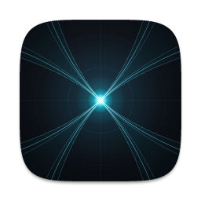
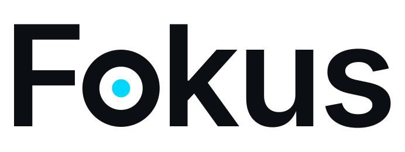
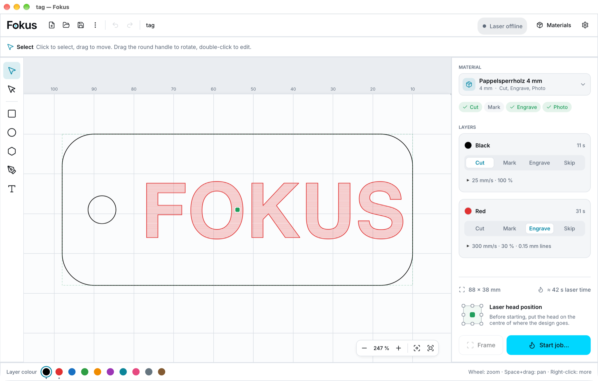
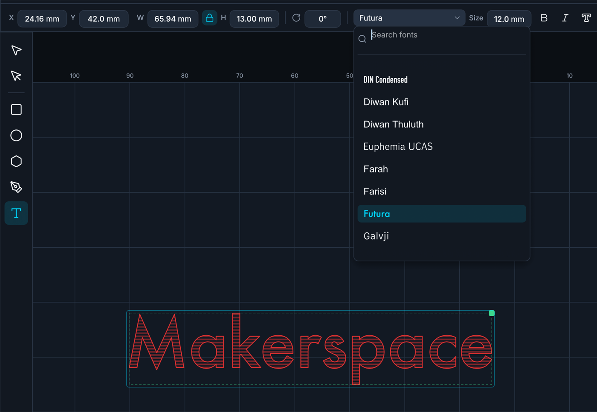
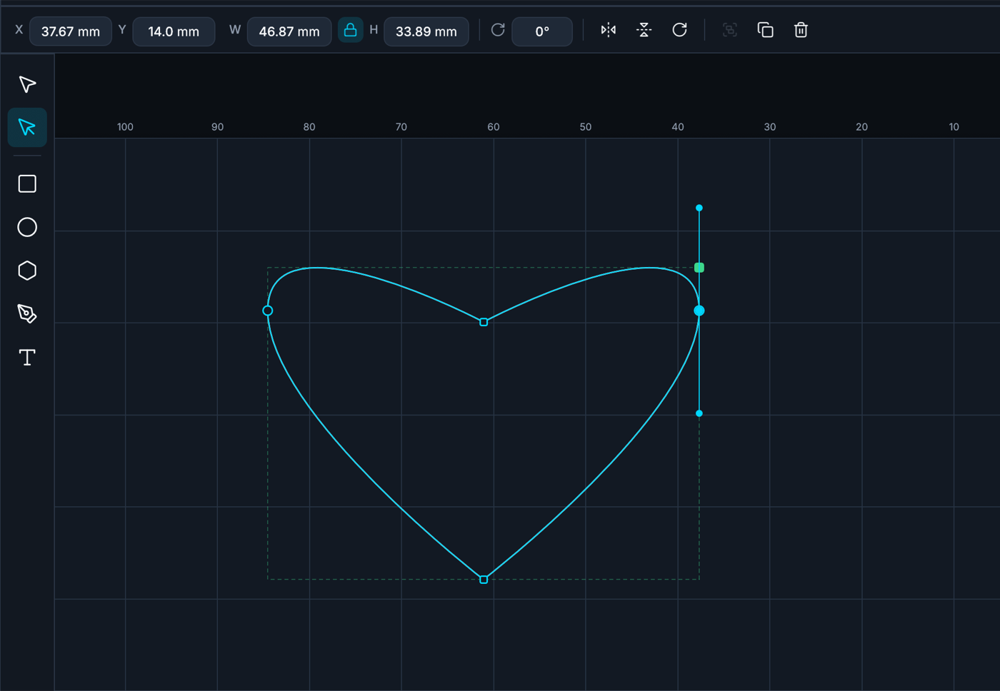
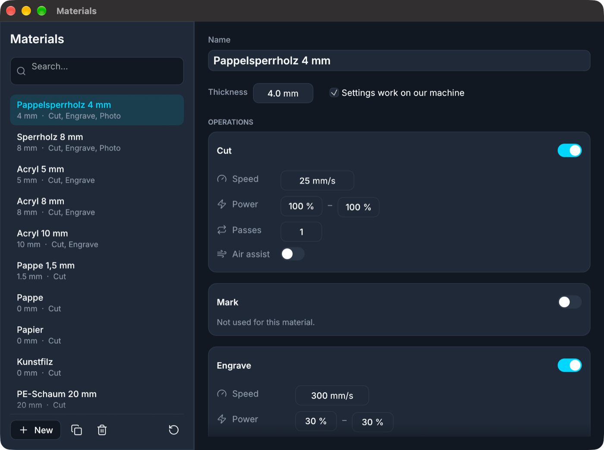
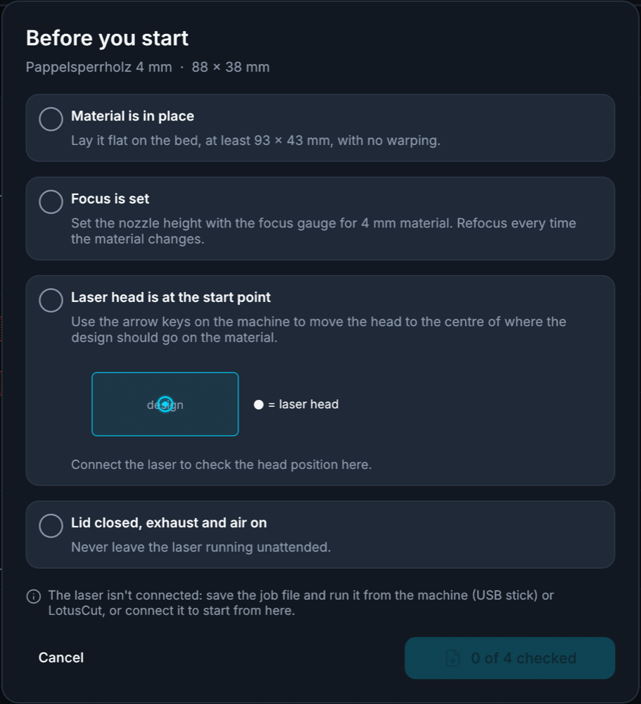
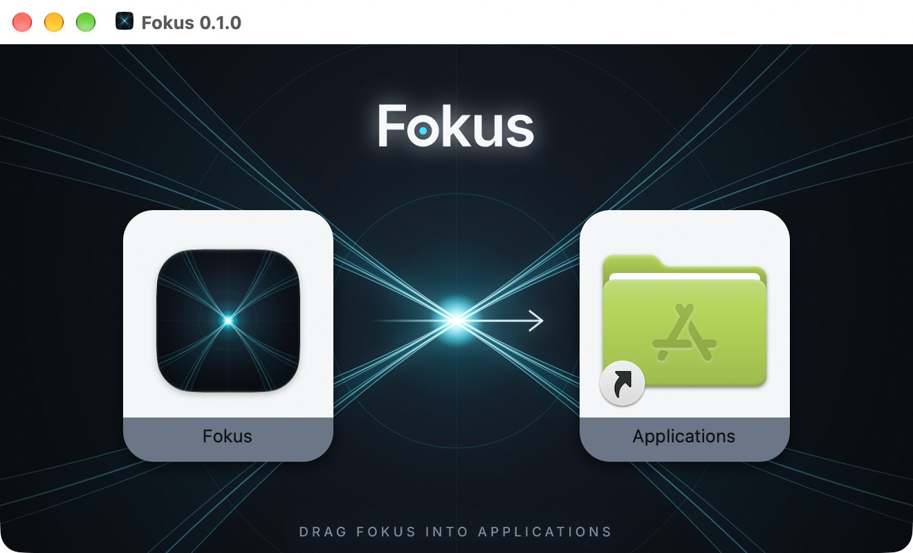

<p align="center">
  
</p>

<h1 align="center">
  <picture>
    <source media="(prefers-color-scheme: dark)" srcset="assets/brand/wordmark/fokus-wordmark-dark.svg">
    
  </picture>
</h1>

<p align="center">
  <b>Laser cutting and engraving, made simple.</b><br>
  For CO2 lasers with a Ruida controller: pick your material, draw or open a design,<br>
  frame it and start. Fokus takes care of speeds and powers and walks you through the rest.
</p>

<p align="center">
  
  
  
  
</p>

<p align="center">
  <a href="#features">Features</a> ·
  <a href="#download">Download</a> ·
  <a href="#your-first-job">Your first job</a> ·
  <a href="#drawing-and-editing">Drawing and editing</a> ·
  <a href="#when-something-doesnt-work">Help</a> ·
  <a href="#how-it-works">How it works</a> ·
  <a href="#development">Development</a> ·
  <a href="#credits">Credits</a>
</p>

<br>

<p align="center">
  <picture>
    <source media="(prefers-color-scheme: dark)" srcset="docs/images/fokus-dark.png">
    
  </picture>
  <br>
  <sub>A key tag ready to go: the black outline is cut, the red lettering engraved, with the settings for 4 mm poplar plywood.</sub>
</p>

Fokus was made for the shared laser in our workshop (a Lasermaxx Plott 100 with a Ruida
RDC6445G) so that anyone can go from an idea to a finished piece, even without laser
experience. It replaces LightBurn and LotusCut for everyday jobs.

## Features

- **Choose a material, not numbers.** Pick *Pappelsperrholz 4 mm* or *Acryl 5 mm* and every
  colour in your design is cut, marked or engraved with the settings for it. The material
  library comes with the values for our machine, and you can add your own.
- **A guided start.** *Frame* drives the head once around your design with the laser off, so you
  see where it will land. Before every job a short checklist asks for the things people forget:
  material flat, focus set, head in place, lid closed, exhaust on.
- **Starts where the head is.** Move the head over your material and pick which point of the
  design sits under it, like in LotusCut. No need to line anything up on screen.
- **Draw right in the app.** Rectangles, ellipses, polygons, a pen for curves, and text in any
  font on your computer, typed straight onto the canvas. Every shape can be edited point by point.
- **Opens your designs.** SVG files from Inkscape, Illustrator or Affinity, with every colour
  becoming a layer. Letters that overlap in a font still engrave solid.
- **Runs the job and watches it.** Fokus sends the job over USB and shows progress, time left,
  *Pause* and *Stop*. If the USB connection drops for a moment, it reconnects by itself and
  keeps following the job.
- **No laser at hand?** Save the job as an `.rd` file and run it from a USB stick.
- **Feels at home.** Light and dark mode, English and German, on Windows, macOS and Linux.

<table>
  <tr>
    <td width="50%"></td>
    <td width="50%"></td>
  </tr>
  <tr>
    <td align="center"><sub>Text in any font on your computer, typed straight onto the canvas.</sub></td>
    <td align="center"><sub>Every shape can be edited point by point.</sub></td>
  </tr>
</table>

<table>
  <tr>
    <td width="58%"></td>
    <td width="42%"></td>
  </tr>
  <tr>
    <td align="center"><sub>The material library, with the settings for our machine.</sub></td>
    <td align="center"><sub>The checklist before every job.</sub></td>
  </tr>
</table>

## Download

Get the latest version from the [releases page](https://github.com/mbirnbach/fokus/releases):

| System | Download | Then |
|---|---|---|
| macOS, Apple chip (M1 or newer) | `fokus-<version>-aarch64-apple-darwin.dmg` | Open it and drag Fokus into Applications. |
| macOS, Intel chip | `fokus-<version>-x86_64-apple-darwin.dmg` | Open it and drag Fokus into Applications. |
| Windows 10/11 | `fokus-<version>-x86_64-pc-windows-msvc.zip` | Unzip it and start `fokus.exe`. |
| Linux x86_64 | `fokus-<version>-x86_64-unknown-linux-gnu.tar.gz` | Unpack it and start `fokus`. |

<p align="center">
  
</p>

> [!NOTE]
> Fokus isn't code-signed yet, so your computer asks once before the first start:
>
> - **macOS** says it can't check the app for malicious software. Open *System Settings →
>   Privacy & Security*, scroll down and click **Open Anyway**. After that it opens normally.
> - **Windows** SmartScreen says *"Windows protected your PC"*: choose **More info → Run anyway**.
> - **Linux:** to use the USB connection, your user may need to be in the `dialout` group
>   (`sudo usermod -aG dialout $USER`, then log out and in again).

Fokus keeps its settings and your material library here:

| System | Folder |
|---|---|
| macOS | `~/Library/Application Support/fokus` |
| Windows | `%APPDATA%\fokus` |
| Linux | `~/.config/fokus` |

## Your first job

1. **Connect the laser.** Switch it on and plug its USB cable into your computer. Fokus finds it
   by itself; the top right then shows *Idle* and the head position. Close LightBurn or LotusCut
   first: only one program can use the laser at a time.
2. **Choose the material** at the top of the right panel. It decides how fast and how strong the
   laser works, so you never have to type speeds or powers yourself.
3. **Make your design.** Draw with the tools on the left, or open an SVG file.
4. **Say what each colour does.** Every colour is a layer. In the right panel pick *Cut*, *Mark*
   (a fine line on the surface), *Engrave* (filled areas, line by line) or *Skip* for each one.
   To change an object's colour, select it and click a colour at the bottom.
5. **Place the head.** Use the arrow keys on the laser to move the head over the spot on your
   material where the design should go. The 3 × 3 picker above *Start job* says which point of
   the design sits under the head (normally the middle).
6. **Frame.** Click *Frame*: the head drives once around your design with the laser off. Move the
   head and frame again until it fits.
7. **Start.** Click *Start job…*, go through the checklist and start. The right panel shows the
   progress, with *Pause* and *Stop*.

> [!WARNING]
> **Never leave the laser alone while it runs.** Stay at the machine until the job is finished.
> *Stop* in Fokus stops the job; the red emergency stop on the machine always works too.

## Drawing and editing

| Tool | Key | How |
|---|---|---|
| Select | `V` | Click to select, drag to move, drag the corners to resize, drag the round handle above to rotate (Shift: 15° steps). Double-click to edit text or points. |
| Points | `A` | Move single points and their curve handles. Double-click the outline to add a point; right-click a point to make it sharp or smooth or to delete it. |
| Rectangle | `R` | Drag. Shift: square. Rounded corners in the bar at the top. |
| Ellipse | `E` | Drag. Shift: circle. |
| Polygon | `Y` | Drag. Number of sides in the bar at the top. |
| Pen | `P` | Click for corners, drag for curves. Click the first point to close the shape, Enter to finish. |
| Text | `T` | Click and type right on the canvas. Font, size, bold and italic are in the bar at the top. |

- The bar at the top shows position and size in millimetres; type exact values there. The lock
  keeps the proportions.
- **Right-click** anything for more: copy, paste, duplicate, bring to front, rotate, flip, group,
  convert to path, colour.
- Mouse wheel to zoom, Space + drag (or the right mouse button) to pan. The buttons at the bottom
  right fit the design or the whole bed into view.
- Arrow keys nudge the selection by 1 mm (Shift: 10 mm).

| Shortcut (⌘ on Mac, Ctrl elsewhere) | |
|---|---|
| ⌘Z / ⇧⌘Z | Undo / redo |
| ⌘C / ⌘X / ⌘V / ⌘D | Copy / cut / paste / duplicate |
| ⌘A | Select all |
| ⌘G / ⇧⌘G | Group / ungroup |
| ⌘] / ⌘[ | Bring to front / send to back |
| ⌘N / ⌘O / ⌘S / ⇧⌘S | New / open / save / save as |
| Delete or Backspace | Delete |

### Projects, materials and settings

- **Save** keeps your work as a `.fokus` project: the design, what every colour does, the
  material and the start point. Text is stored with its letter shapes, so a project looks the
  same on a computer without that font. **Open** reads `.fokus` projects, `.svg` designs and `.rd`
  job files (as a preview). The **⋮** menu has *Save as* and *Export job file (.rd)*.
- **Materials** (top right) opens the material library. It comes with the settings for the
  materials in our workshop, taken from the machine's reference sheet; those marked *untested*
  haven't been tried on our laser yet. Adjust them, add your own or copy existing ones. To change
  speed or power for one job only, click the small triangle under a layer.
- **Settings** (the gear) has the laser connection, which corner is the machine's origin, the
  language (follows your system unless you choose) and light or dark mode.

## When something doesn't work

- **"Laser offline", or the laser isn't found:** check the laser is on and the USB cable is
  plugged in, and close LightBurn or LotusCut. In *Settings* you can pick the port by hand and
  click *Connect*.
- **"Connection problem" while a job runs:** USB connections next to a laser sometimes drop out
  for a moment. The laser has the whole job and carries on; Fokus reconnects by itself and tells
  you to check the piece afterwards.
- **The design ended up in the wrong place:** the job starts where the head is, not where the
  design sits on the screen. Use *Frame* before every job.
- **Engraving too light or too dark, or a cut doesn't go through:** check the focus first (set it
  with the focus gauge for your material's thickness), then adjust the layer's speed and power.

### What has been tested

On our laser: cutting and engraving (also text set in Fokus), sending over USB, start points,
framing, pause and resume, stop, and reconnecting after the USB cable was pulled. Not yet
available: photo engraving. Not yet tried on real hardware: the Windows and Linux builds.

## How it works

```
fokus/          the desktop app (Rust and egui): canvas, layers, materials, jobs
  locales/      the English and German texts (Fluent files)
ruida/          the Ruida protocol: .rd job files, the USB connection, status and job sending
assets/brand/   the app icon, wordmark and DMG background, generated from scripts
packaging/      what goes into the downloads (Info.plist, DMG layout, Linux desktop entry)
```

A design is a set of shapes, each with a colour. When you start a job, Fokus turns every colour
into a layer with the material's settings for its operation: cut and mark layers become
toolpaths, engrave layers are filled line by line. The [`ruida`](ruida/) crate writes that as a
Ruida job file, the same format LightBurn writes, and sends it to the controller over USB,
watching its status until the job is done. The protocol is based on the community's reverse
engineering, mainly [MeerK40t](https://github.com/meerk40t/meerk40t)'s Ruida driver, and checked
against real LightBurn jobs for our controller.

## Development

```bash
cargo run -p fokus                                  # run the app
cargo test --workspace                              # all tests
cargo run -p fokus -- design.svg --export job.rd --material "Pappelsperrholz 4 mm"   # a job file without the window
cargo run -p ruida --bin rd-dump -- job.rd --svg preview.svg                         # decode a job file
cargo run -p ruida --bin rd-status -- --watch                                        # read-only machine status
```

Linux needs `libudev-dev libgtk-3-dev libxkbcommon-dev pkg-config` to build.

*Actions → Release builds → Run workflow* builds the downloads for all platforms as workflow
artifacts; publishing a GitHub release (with a tag like `v0.1.0`) runs the same workflow and
attaches them to the release. [`scripts/package.sh`](scripts/package.sh) packages one platform
locally (the DMG needs `dmgbuild`, which it installs on first use). The brand art is generated;
see [`assets/brand/README.md`](assets/brand/README.md) to change or rebuild it. More about the
app's structure is in [`fokus/README.md`](fokus/README.md), about the protocol in
[`ruida/README.md`](ruida/README.md).

## Credits

- [Inter](https://rsms.me/inter/) by Rasmus Andersson, the typeface of the app and the wordmark,
  under the SIL Open Font License ([`fokus/fonts/LICENSE.inter`](fokus/fonts/LICENSE.inter)).
- [Lucide](https://lucide.dev) icons, under the ISC License
  ([`fokus/icons/LICENSE.lucide`](fokus/icons/LICENSE.lucide)).
- [MeerK40t](https://github.com/meerk40t/meerk40t), whose Ruida driver much of the protocol work
  is based on.
- Built with [egui](https://github.com/emilk/egui), [usvg / resvg](https://github.com/linebender/resvg)
  and [serialport](https://github.com/serialport/serialport-rs).
