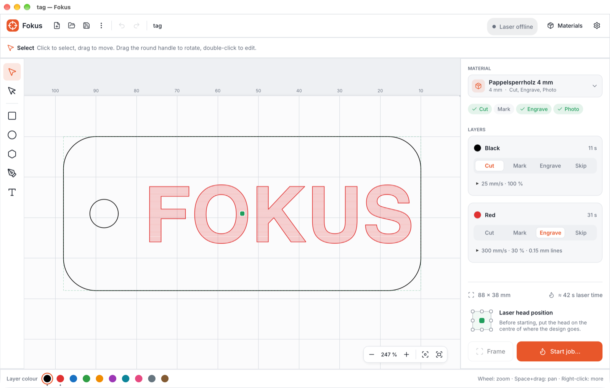

# Fokus

Fokus is a simple program for laser cutting and engraving on CO2 lasers with a
Ruida controller. It was made for the shared laser in our workshop (Lasermaxx
Plott 100) so that anyone can go from an idea to a finished piece, even
without laser experience: pick your material, draw or open a design, and
Fokus takes care of the speeds and powers and walks you through the start.

It runs on Windows, macOS and Linux, in English and German.



## Download and install

Download the latest version from the **Releases** page of this repository and
pick the file for your computer:

| Computer | File |
|---|---|
| Windows | `fokus-…-x86_64-pc-windows-msvc.zip` |
| Mac with Apple chip (M1 or newer) | `fokus-…-aarch64-apple-darwin.dmg` |
| Mac with Intel chip | `fokus-…-x86_64-apple-darwin.dmg` |
| Linux | `fokus-…-x86_64-unknown-linux-gnu.tar.gz` |

- **Windows:** unzip and start `fokus.exe`. If Windows warns that it
  protected your PC, click *More info → Run anyway*.
- **macOS:** open the `.dmg` and drag *Fokus* into *Applications*. The first time,
  right-click it and choose *Open*, then confirm; after that it opens
  normally.
- **Linux:** unpack and start `fokus`. To use the USB connection you may need
  to be in the `dialout` group (`sudo usermod -aG dialout $USER`, then log out
  and in again).

## Your first job

1. **Connect the laser.** Switch it on and plug its USB cable into your
   computer. Fokus finds it by itself; the top right then shows *Idle* and
   the head position. (Close LightBurn or LotusCut first: only one program can
   use the laser at a time.)
2. **Choose the material** at the top of the right panel, e.g. *Pappelsperrholz
   4 mm*. It decides how fast and how strong the laser works, so you never
   have to type speeds or powers yourself.
3. **Make your design.** Draw with the tools on the left, or open an SVG file
   (from Inkscape, Illustrator, Affinity, …).
4. **Say what each colour does.** Every colour is a layer. In the right panel
   pick *Cut*, *Mark* (a fine line on the surface), *Engrave* (filled areas,
   line by line) or *Skip* for each one. Change an object's colour by
   selecting it and clicking a colour at the bottom.
5. **Place the head.** Use the arrow keys on the laser to move the head over
   the spot on your material where the design should go. The little 3 × 3
   picker above *Start job* says which point of the design sits under the
   head (normally the middle).
6. **Frame.** Click *Frame*: the head drives once around your design with the
   laser off, so you can see exactly where it will land. Move the head and
   frame again until it fits.
7. **Start.** Click *Start job…*, go through the short checklist (material
   flat, focus set, head in place, lid closed, exhaust and air on) and start.
   The right panel shows the progress, with *Pause* and *Stop*.

> **Never leave the laser alone while it runs.** Stay at the machine until the
> job is finished. *Stop* in Fokus stops the job; the red emergency stop on
> the machine always works too.

No laser at hand? *Start job… → Save job file* writes an `.rd` file you can
take to the laser on a USB stick.

## Drawing and editing

| Tool | Key | How |
|---|---|---|
| Select | `V` | Click to select, drag to move, drag the corners to resize, drag the round handle above to rotate (Shift: 15° steps). Double-click to edit text or points. |
| Points | `A` | Move single points and their curve handles. Double-click the outline to add a point; right-click a point to make it sharp or smooth or to delete it. |
| Rectangle | `R` | Drag. Shift: square. Rounded corners in the bar at the top. |
| Ellipse | `E` | Drag. Shift: circle. |
| Polygon | `Y` | Drag. Number of sides in the bar at the top. |
| Pen | `P` | Click for corners, drag for curves. Click the first point to close the shape, Enter to finish. |
| Text | `T` | Click and type right on the canvas. Font, size, bold and italic are in the bar at the top. |

- The bar at the top shows position and size in millimetres; type exact
  values there. The lock keeps the proportions.
- **Right-click** anything for more: copy, paste, duplicate, bring to front,
  rotate, flip, group, convert to path, colour.
- Moving around: mouse wheel to zoom, Space + drag (or the right mouse
  button) to pan. The buttons at the bottom right fit the design or the
  whole bed into view.
- Arrow keys nudge the selection by 1 mm (Shift: 10 mm).

| Shortcut (⌘ on Mac, Ctrl elsewhere) | |
|---|---|
| ⌘Z / ⇧⌘Z | Undo / redo |
| ⌘C / ⌘X / ⌘V / ⌘D | Copy / cut / paste / duplicate |
| ⌘A | Select all |
| ⌘G / ⇧⌘G | Group / ungroup |
| ⌘] / ⌘[ | Bring to front / send to back |
| ⌘N / ⌘O / ⌘S / ⇧⌘S | New / open / save / save as |
| Delete or Backspace | Delete |

## Projects and files

- **Save** keeps your work as a `.fokus` project: the design, what every
  colour does, the material and the start point. Text is stored with its
  letter shapes, so a project looks the same on a computer without that font.
- **Open** reads `.fokus` projects, `.svg` designs and `.rd` job files (shown
  as a preview).
- The **⋮** menu has *Save as* and *Export job file (.rd)*.

## Materials

*Materials* (top right) opens the material library. It comes with settings
for the materials in our workshop, taken from the machine's reference sheet.
Settings marked *untested* haven't been tried on our laser yet. You can adjust them,
add your own materials and copy existing ones; the library is saved on your
computer.

## Settings

The gear icon opens the settings: the laser connection, which corner is the
machine's origin, language (follows your system unless you choose), and
appearance (system, light or dark).

## When something doesn't work

- **"Laser offline" / the laser isn't found:** check the laser is on and the
  USB cable is plugged in, and close LightBurn or LotusCut. In *Settings* you
  can pick the port by hand and click *Connect*.
- **"Connection problem" while a job runs:** USB connections next to a laser
  sometimes drop out for a moment. The laser has the whole job and carries on;
  Fokus reconnects by itself and tells you to check the piece afterwards.
- **The design ended up in the wrong place:** the job starts where the head
  is, not where the design sits on the screen. Use *Frame* before every job.
- **Engraving looks too light or too dark, or a cut doesn't go through:** check
  the focus first (set it with the focus gauge for your material's
  thickness). Then adjust the layer's settings: click the small triangle
  under the layer to change speed and power for this job only.

## Status

Tested on our laser: cutting and engraving (also text set in Fokus), sending
over USB, start points, framing, pause / resume, stop, and reconnecting after
the USB cable was pulled. Not yet available: photo engraving. Not yet tried on
real hardware: the Windows and Linux builds.

## For developers

Fokus is written in Rust. The repository has two parts:

| Folder | What |
|---|---|
| [`fokus/`](fokus/) | The desktop app (egui). See [fokus/README.md](fokus/README.md). |
| [`ruida/`](ruida/) | The Ruida protocol: `.rd` files (read and write), USB connection, status and job sending, plus command-line tools. See [ruida/README.md](ruida/README.md). |
| `fokus/locales/` | Translations ([Fluent](https://projectfluent.org) files). |
| `packaging/`, `scripts/package.sh` | Packaging for the downloads. |
| `.github/workflows/` | Tests on every push; builds for all platforms on request or when a release is published. |

Building needs [Rust](https://rustup.rs) (stable); Linux also needs
`libudev-dev libgtk-3-dev libxkbcommon-dev pkg-config`.

```bash
cargo run -p fokus                     # the app
cargo test --workspace                 # all tests
```

Command-line tools from the `ruida` crate:

```bash
cargo run -p ruida --bin rd-dump -- job.rd --svg preview.svg   # decode a job file
cargo run -p ruida --bin rd-status -- --watch                  # read-only machine status
cargo run -p ruida --bin rd-send -- job.rd                     # send a job (asks first)
```

**Builds and releases:** *Actions → Release builds → Run workflow* builds
Fokus for Windows, Linux and macOS (Apple chip and Intel) and keeps the
downloads as workflow artifacts. Publishing a GitHub release (with a tag such
as `v0.1.0`) runs the same workflow and attaches the downloads to the release.
